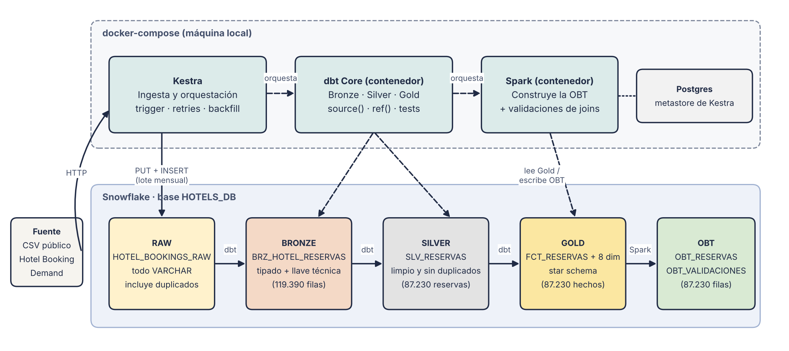

# PSet 2: Pipeline ELT de cancelaciones de reservas de hotel

Pipeline reproducible **Fuente → Kestra → RAW → dbt → BRONZE → SILVER → GOLD → Spark → OBT** en Snowflake.
Proyecto: predecir si una reserva de hotel se cancelará (dataset *Hotel Booking Demand*).



## ¿Qué hace cada pieza?
| Pieza | Responsabilidad | Dónde está |
|---|---|---|
| **Kestra** | Descarga la fuente, la carga a `RAW` por lotes mensuales (trigger, retries, backfill) y orquesta dbt y Spark | `kestra/flows/` |
| **dbt** | `RAW → BRONZE → SILVER → GOLD` (limpieza, star schema y tests) | `dbt/` |
| **Spark** | Une Gold en una One Big Table y valida los joins; escribe `OBT` | `spark/` |
| **Snowflake** | Destino de todas las capas | `snowflake/setup.sql` |

## Requisitos
- Docker Desktop (con Docker Compose v2) y 6 GB de RAM libres.
- Una cuenta de Snowflake (sirve la prueba gratuita) y un usuario con contraseña.
- Git, y este repositorio subido a GitHub si quieres que Kestra orqueste dbt y Spark (flujo 03).

## Puesta en marcha (paso a paso)

### 1. Preparar Snowflake (una sola vez)
Abre una *worksheet* en Snowflake, pega `snowflake/setup.sql`, cambia `TU_USUARIO` por tu usuario y ejecútalo.
Crea el rol `PSET2_ROLE`, el warehouse `WH_PSET2`, la base `HOTELS_DB` y los esquemas `RAW`, `BRONZE`, `SILVER`, `GOLD` y `OBT`.

### 2. Configurar credenciales (nunca se suben al repo)
```bash
cp .env.example .env            # completa SNOWFLAKE_ACCOUNT, SNOWFLAKE_USER, SNOWFLAKE_PASSWORD, KESTRA_USER, KESTRA_PASSWORD y KESTRA_DB_PASSWORD
./scripts/encode_secrets.sh     # genera .env_encoded (secretos en base64 para Kestra)
```
`SNOWFLAKE_ACCOUNT` es el identificador sin `.snowflakecomputing.com` (por ejemplo `xy12345.us-east-1`).

### 3. Levantar la infraestructura
```bash
docker compose up -d            # Kestra + Postgres
docker compose build spark      # imagen de Spark con PySpark 3.5 y Java 17
```
Entra a Kestra en http://localhost:8080 con el usuario y la clave que pusiste en `.env`. Los flujos del namespace `pset2.hotels` se cargan solos.

### 4. Ejecutar el pipeline
**Opción A, todo desde Kestra (recomendada)**
1. Ejecuta `hotel_00_setup_raw` (crea file format, stage y tabla RAW; es idempotente).
2. Ejecuta `hotel_02_backfill_raw`: carga los 26 meses (2015-07 a 2017-08) en RAW y al final lanza `hotel_03_elt_pipeline` (dbt + Spark).
   - Antes, en `hotel_03_elt_pipeline` cambia la variable `repo_url` por la URL de tu repositorio.

**Opción B, paso a paso desde la terminal**
```bash
docker compose run --rm dbt deps
docker compose run --rm dbt build          # Bronze, Silver, Gold y todos los tests
docker compose run --rm spark              # construye la OBT y valida los joins
```
(La ingesta a RAW siempre se hace con los flujos 00 y 02 de Kestra.)

### 5. Verificar en Snowflake
```sql
USE ROLE PSET2_ROLE; USE DATABASE HOTELS_DB;
SELECT 'RAW' capa, COUNT(*) filas FROM RAW.HOTEL_BOOKINGS_RAW        -- esperado 119390
UNION ALL SELECT 'BRONZE', COUNT(*) FROM BRONZE.BRZ_HOTEL_RESERVAS    -- 119390
UNION ALL SELECT 'SILVER', COUNT(*) FROM SILVER.SLV_RESERVAS          -- 87230
UNION ALL SELECT 'GOLD',   COUNT(*) FROM GOLD.FCT_RESERVAS            -- 87230
UNION ALL SELECT 'OBT',    COUNT(*) FROM OBT.OBT_RESERVAS;            -- 87230
SELECT * FROM OBT.OBT_VALIDACIONES ORDER BY EJECUTADO_EN DESC;        -- todos los chequeos en ok = true
```

## Ingesta: trigger, retries y backfill
- **Trigger y frecuencia:** el flujo `hotel_01_ingest_raw` corre el día 1 de cada mes a las 02:00 (America/Guayaquil) y carga el mes cerrado anterior. El flujo 03 corre a las 04:00.
- **Retries:** descarga, subida al stage, borrado y carga reintentan con *backoff* exponencial (10 s a 2 min, 4 intentos). Si todo falla, el bloque `errors` deja un mensaje con el lote y la ejecución.
- **Idempotencia:** cada lote borra sus filas (`_BATCH_ID`) antes de insertarlas, así repetir o reintentar no duplica datos.
- **Backfill:** dos formas: (a) `hotel_02_backfill_raw` recorre los 26 meses en secuencia; (b) pestaña *Triggers → Backfill* del flujo 01 con el rango 2015-08-01 a 2017-09-01.

## Pruebas
- **dbt:** `docker compose run --rm dbt build` ejecuta los tests de `not_null`, `unique`, `relationships`, `accepted_values`, rangos y los tests de reglas de negocio (`dbt/tests/`).
- **Spark sin Snowflake:** `python spark/test_obt_local.py hotels.csv` replica Silver/Gold con pandas, corre la misma lógica de la OBT y comprueba que las validaciones pasan y que fallan si se rompe una dimensión (resultado en `docs/resultado_prueba_local_obt.txt`).
- **Perfilado de calidad:** `python scripts/profile_quality.py hotels.csv`.

## Estructura
```
pset_2/
├── docker-compose.yml        .env.example        README.md
├── kestra/flows/             flujos 00 (setup), 01 (ingesta), 02 (backfill), 03 (dbt + Spark)
├── dbt/                      models/{bronze,silver,gold}, tests/, macros/
├── spark/                    Dockerfile, build_obt.py, test_obt_local.py
├── snowflake/setup.sql       rol, warehouse, base y esquemas
├── scripts/                  encode_secrets.sh, profile_quality.py
└── docs/                     arquitectura, star schema, calidad de datos, diccionario
```

## Seguridad
`.env` y `.env_encoded` están en `.gitignore`. El repositorio solo contiene `.env.example` sin valores. Si subes una credencial por error, cámbiala en Snowflake de inmediato.

## Limitaciones conocidas
Ver la sección 7 del documento técnico y `docs/calidad_datos.md`.
